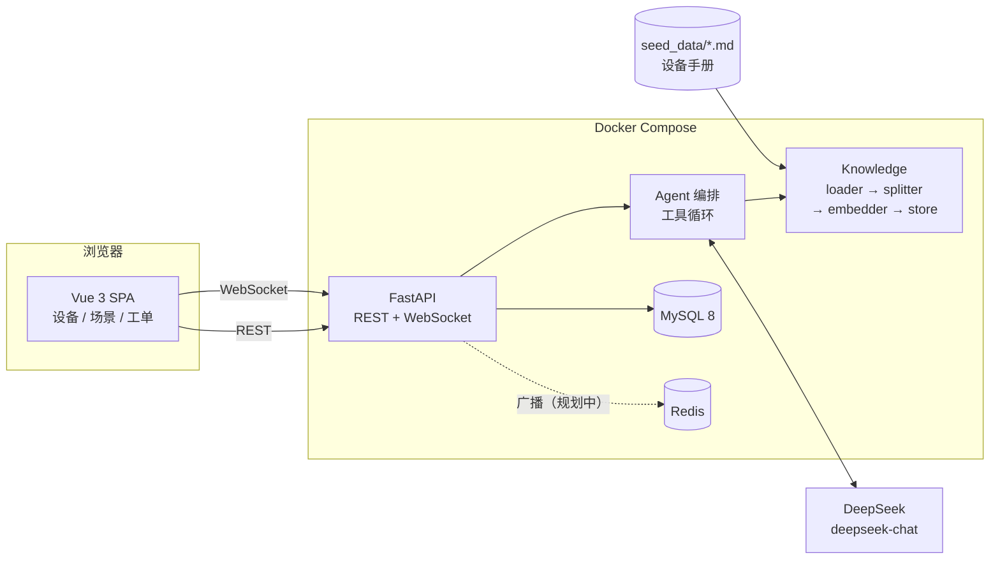

# SmartHome Ops Platform

> 智能家居运维平台 —— 家庭端设备管理与场景编排 · 维修端工单协同 · RAG 知识库 · **AI 客服 Agent**

一套完整的「家庭用户 ↔ 维修人员」双角色闭环系统：家庭用户管理设备、编排场景、提交报修；
维修人员在工单池接单、流转状态、与业主实时沟通；
用户也可以直接和 AI 客服对话——它会**先查知识库、再查真实设备状态，然后决定是否替你建单**。

---

## 功能

**家庭用户**
- 设备增删改查、在线状态、远程开关
- 设备表单按**类型目录**动态渲染：选「空调」出现模式/温度，选「电视」出现音量/频道，
  取值范围由后端统一下发（`GET /api/device-types`），前后端不会各写一份枚举
- 场景编排：任意设备组合成「回家 / 离家 / 晚安」，一键批量执行
- 提交报修工单，与维修人员对话

**维修人员**
- 工单池浏览、接单（认领）、状态流转 `open → assigned → in_progress → resolved / cancelled`
- 工单内实时聊天

**AI 客服 Agent**（页面右下角悬浮入口 / `POST /api/assistant/chat`）
- 6 个可调用工具：知识库检索、设备列表、设备状态、工单列表、创建工单、**场景设计**
- **把「感受」翻译成「方案」**：用户说「晚上睡不好，感觉空气很粘」，
  它会判断这是湿度问题 → 查设备 → 产出「睡前除湿助眠」草案（空调除湿 26°C、灯调暗），
  界面直接给出「一键布设」按钮
- 草案携带**目标参数**而不只是开关（`{"mode":"dry","temperature":26}`），
  场景动作表因此增加了 `attributes` 字段
- 支持多轮修改：用户说「水温再高点到 60、玄关灯降到 30%」，
  它基于上一版草案增量调整后重新出方案
- 先检索再回答，答案带**文档溯源**；信息不足时主动追问；涉及安全风险先给断电/通风提示

**实时能力**
- 设备状态变更、工单变更、新消息，全部通过 WebSocket 秒级推送到相关客户端
- 按家庭维度隔离：维修人员能看到自己名下的工单事件，家庭用户只看自己家

**知识库（RAG）**
- 5 篇设备手册按 Markdown 标题层级切分，得到 10 个语义块（纯标题块已被过滤）
- 向量召回 + BM25 关键词召回，用 **RRF（倒数排名融合）** 合并两路结果
- 向量后端可切换：Qdrant（生产）/ 本地 JSON（开发）

**数据统计与数据库能力**
- 3 个数据库视图：家庭设备能耗、维修人员绩效、家庭报修历史
- 1 个数据库触发器：工单状态变化时自动记录流转日志并回填 `resolved_at`
- 复合索引：`(home_id, status)`、`(home_id, type)`、`(assigned_to)`、`(priority)`
- 复杂查询：多表连接聚合、HAVING 嵌套子查询、自连接去重，前端「数据统计」页可见

---

## 架构



### Agent 一次对话的真实链路

```
用户：帮我报修一下，主卧的灯一直在闪
  │
  ├─▶ search_knowledge("灯具 闪烁")        → light_pro.md / faq.md
  ├─▶ get_device_status("主卧")            → 没找到「灯」，只有空气传感器
  │
  └─▶ 模型判断：信息不足且涉及安全
        → 先给断电提醒，再追问「普通灯还是智能灯、是否已断电」

用户：是普通吸顶灯，已经断电了
  │
  └─▶ create_work_order(标题, 描述)        → 工单 #2 已创建
```

---

## 技术栈

| 层 | 选型 |
|---|---|
| 前端 | Vue 3 + TypeScript + Vite |
| 后端 | FastAPI + SQLAlchemy + Pydantic v2 |
| 数据库 | MySQL 8（生产）/ SQLite（本地开发） |
| 实时 | WebSocket（原生）+ 按家庭分组的连接注册表 |
| 检索 | BM25 + 向量检索 + RRF 融合，Qdrant / JSON 双后端 |
| 大模型 | DeepSeek `deepseek-chat`（OpenAI 兼容协议，工具调用） |
| 部署 | Docker Compose |

---

## 关键设计

### 1. RBAC：角色 + 权限 + 家庭归属三层

不只是「登录了就能用」。`role_permissions` 表维护角色到权限的映射，数据访问还要再过一道
**家庭归属校验**（`home_for_user`）：即使你有 `home_user` 角色，也只能操作自己家的设备和工单。

```python
def find_device(db, device_id, user) -> Device:
    require_role(user, {"home_user"})
    device = db.get(Device, device_id)
    if device is None:
        raise HTTPException(404, "device_not_found")
    if device.home_id != home_for_user(db, user):
        raise HTTPException(403, "home_access_denied")   # 跨家庭访问直接拒绝
    return device
```

### 2. 工单状态机

维修人员不能任意改状态，受两条约束：**必须是自己接的单**，且接单只能从 `open/assigned` 进入。

```
  [open] ────── accept ──────► [assigned] ──► [in_progress] ──► [resolved]
    │                             │
    └──────── cancel ─────────────┴──────────► [cancelled]
```

### 3. 混合检索 + RRF 融合

单一向量检索对「设备型号」「错误码」这类精确词不敏感，单一 BM25 又抓不住语义改写。
所以两路各取 Top-N，用 RRF 合并——它只看**排名**不看原始分数，天然免疫两路分数量纲不一致的问题：

```
score(doc) = Σ  1 / (k + rank_i(doc))     k = 60
            i∈各路检索
```

实现见 `app/services/agent/knowledge/retriever.py`。

**为什么过滤纯标题块**：切分时 `# 一级标题` 会被切成一个只有标题、没有正文的块。
这类块在向量空间里与文档主题高度相似，实测会抢占 Top-1（原来 15 块，"空调开不起来" 召回的是
`# AC-2000 智能空调` 这行标题）。过滤后降到 10 块，Top-1 变成真正的排查正文。

### 4. Agent：工具循环与框架解耦

`app/services/agent/` 完全不认识 FastAPI 和 SQLAlchemy：

| 模块 | 职责 |
|---|---|
| `llm.py` | DeepSeek 客户端，返回原始 assistant message（便于把 tool_calls 原样回传） |
| `tools.py` | 通用工具注册表，把函数包装成 JSON Schema，并安全分发调用 |
| `assistant.py` | 多轮编排：模型决定调工具 → 执行 → 结果回灌 → 直到给出答案 |
| `knowledge/` | 检索能力 |

业务工具（查设备、建工单）在 `backend/api/assistant.py` 里注册，**按当前登录用户构造**，
所以 Agent 天然继承了 RBAC：它只能看到你家的设备，也只能替你建单。

工具调用失败不会中断对话——错误会被包装成 `{"error": ...}` 回传给模型，让它自己纠正重试。

### 5. 降级设计：外部依赖挂了不能整站不可用

`create_embedder()` 按环境变量在 vLLM / 本地 Hash 之间切换，无外网环境也能跑通检索链路。
向量后端同理：`KNOWLEDGE_VECTOR_BACKEND=qdrant|json`。LLM 未配置时 `/api/assistant/chat`
返回 503，其余功能完全不受影响。

> 注意：DeepSeek 官方 API **不提供 embedding 接口**（`/v1/embeddings` 实测返回 404），
> 因此「生成」用 DeepSeek、「向量化」必须另接服务。这也是本项目把 embedding 层独立成模块的原因。

### 6. 数据库对象：视图 / 触发器 / 索引

`backend/db_objects.py` 在启动时幂等创建这些对象，**用 information_schema 判存在**，
而不是匹配异常字符串（后者一旦错误信息本地化就会失效）。

| 对象 | 用途 |
|---|---|
| `v_home_device_stats` | 每个家庭的设备总数、在线数、开启数、总功耗与运行功耗 |
| `v_technician_stats` | 维修人员接单量、完成量、平均工时、平均费用 |
| `v_home_repair_history` | 家庭维度报修量、待办量、累计费用 |
| `trg_work_order_status_change` | `BEFORE UPDATE` 写 `work_order_events`，状态变为 resolved 时回填 `resolved_at` |

**为什么日志放触发器而不是应用层**：工单状态会被「接单」「状态流转」「完工登记」三条路径修改，
应用层写日志总会漏。交给数据库，任何一条 UPDATE 都逃不掉。

**代价也要说清楚**：MySQL 之外的方言（本地 SQLite）没有等价语法，启动时自动跳过，
统计接口降级为 ORM 查询并在响应里标注 `view_source`。
另外 SQLAlchemy 的 `expire_on_commit=False` 意味着 ORM 对象**看不到触发器写入的值**，
读取触发器产生的字段必须重新查库或单独查询。

### 7. 复杂查询三种写法

| 类型 | 接口 | 说明 |
|---|---|---|
| 多表连接 + 条件聚合 | `/api/stats/overview` | `homes ⨝ devices`，用 `CASE WHEN` 分别统计在线/开启/运行功耗 |
| 嵌套子查询 | 同上 `rooms_above_average` | `HAVING COUNT(*) > (SELECT AVG(cnt) FROM (... GROUP BY room))` |
| 自连接 | 同上 `cross_type_rooms` | `devices ⨝ devices`，`a.type < b.type` 去重，找同房间不同类型设备 |

### 8. 场景动作：从 JSON 列到关联表

最初 `scenes.actions` 是一个 JSON 数组（`[{"device_id": 1, "action": "on"}]`）。写起来省事，但三个问题：

1. 无法用 SQL 聚合——「动作最多的场景」只能在 Python 里 `max()`；
2. 没有参照完整性——设备被删了，JSON 里的 `device_id` 还留着；
3. 没有唯一约束——同一个设备可以重复出现在一个场景里。

现在改成 `scene_actions(scene_id, device_id, action)` 关联表：

```sql
UNIQUE KEY uq_scene_actions_scene_device (scene_id, device_id)   -- 一场景一设备一条
FOREIGN KEY (scene_id)  REFERENCES scenes(id)  ON DELETE CASCADE
FOREIGN KEY (device_id) REFERENCES devices(id) ON DELETE CASCADE
```

**两个实现细节值得记**：

- **差量更新**：PUT 场景时不能「全删再全插」，否则会撞唯一约束。改为按 `device_id` 求差集：改动作、加新行、删旧行。
- **删除设备**：SQLite 默认不强制外键，所以 `delete_device` 里显式 `DELETE FROM scene_actions WHERE device_id = ?`，不能只依赖 `ON DELETE CASCADE`。

迁移是原地完成的：启动时读旧 JSON 列 → 写入新表 → `ALTER TABLE scenes DROP COLUMN actions`，
不会留下"同一份数据两个来源"。

### 9. 设备参数：这次为什么又用 JSON

刚把场景动作从 JSON 改成关联表，设备参数却反过来用了 `devices.attributes` JSON 列。
判断标准不是"JSON 好不好"，而是**数据形状**：

| | 场景动作 | 设备参数 |
|---|---|---|
| 基数 | 一个场景 N 台设备，是真正的多对多 | 一台设备一组键值，不跨表关联 |
| 约束 | 需要 `UNIQUE(scene, device)` 防重复 | 键随类型变，无法建固定列 |
| 查询 | 要按设备聚合（JOIN） | 只随设备整体读写，从不 JOIN |
| 结论 | **关联表** | **JSON + 写入校验** |

关键在最后半句：**JSON 列如果不校验就是无底洞**。`backend/device_types.py` 把
「哪些类型、允许哪些键、取值范围、非法值报什么错」集中成唯一事实来源：

```python
"air_conditioner": {
    "mode":        {"type": "enum", "choices": ["cool", "heat", "dry", "fan"], "default": "cool"},
    "temperature": {"type": "int",  "min": 16, "max": 30, "default": 24},
}
```

写入时 `normalize_attributes()` 做白名单过滤 + 范围校验，越界直接 422：
`{"detail": "invalid_attribute:temperature"}`。同一份规则通过 `/api/device-types`
下发给前端渲染表单，所以三处（后端校验、前端控件、文档）永远一致。

### 10. Agent 如何把「感受」变成「方案」

这是本项目最核心的一条链路，也是它区别于「CRUD + 聊天框」的地方。

```
用户：晚上睡不好，感觉空气很粘
  │
  ├─▶ list_devices()                看到空调支持 mode/temperature、灯支持 brightness
  ├─▶ search_knowledge("潮湿 睡眠")  手册给出温度建议
  └─▶ propose_scene(                产出结构化草案，不落库
        name="睡前除湿助眠",
        actions=[
          {device:"客厅中央空调", action:"on",  attributes:{mode:"dry", temperature:26}},
          {device:"主卧台灯",     action:"on",  attributes:{brightness:10}},
          {device:"玄关智能灯",   action:"off"}
        ])
  ▼
前端渲染草案卡片（设备 · 目标值 + 布设理由）→ 用户点「一键布设」
  ▼
POST /api/scenes  ← 复用普通场景接口，草案变成真实场景
```

**几个刻意的设计**：

| 决定 | 原因 |
|---|---|
| 草案**不落库** | 用户可以看完再决定，避免一堆 AI 生成的垃圾场景 |
| 单独一个 `propose_scene` 工具 | 若让模型直接调建场景接口，它会边想边建，产生半成品 |
| 只保留用户真正要改的参数 | `normalize_attributes` 会补默认值，但写进场景的只留显式指定的键，否则会莫名覆盖其他参数 |
| `last_proposal` 随请求回传 | 用户说「再低一点」时，模型需要看到上一版才能增量修改，而不是从零重来 |
| 布设走普通场景接口 | Agent 没有特权通道，权限、校验、事务和人工创建完全一致 |

配套的提示词约束：**必须调用 `propose_scene` 产出方案，不能只在文字里描述**。
早期版本模型会礼貌地反问「要不要我帮你设计」，导致用户还要多点一次；
把这条写进系统提示词后行为才稳定。

---

## 快速开始

### 方式一：Docker Compose（推荐）

```bash
cp .env.example .env      # Windows: Copy-Item .env.example .env
# 填入 DEEPSEEK_API_KEY
docker compose up --build -d
```

| 服务 | 地址 |
|---|---|
| API 文档 | http://localhost:8000/docs |
| 健康检查 | http://localhost:8000/api/health |
| AI 客服 | `POST /api/assistant/chat` |
| MySQL | localhost:3308（容器内 mysql:3306，可用 `MYSQL_HOST_PORT` 覆盖） |
| Redis | localhost:6379 |

> 国内网络直连 Docker Hub / PyPI 不通时，在 `.env` 里指定 `PYTHON_IMAGE` 和 `PIP_INDEX_URL`
> 即可切换镜像源（`.env.example` 里有注释示例）。

### 方式二：本地开发

```bash
# 前端
npm install
npm run dev            # http://localhost:5173

# 后端（另开终端）
py -m pip install -r backend/requirements.txt
py -m uvicorn backend.main:app --reload --port 8000
```

本地不启 MySQL 时，用 SQLite 即可：

```powershell
$env:DATABASE_URL = "sqlite:///./smarthome_dev.db"
py -m uvicorn backend.main:app --reload --port 8000
```

### 测试账号

| 账号 | 密码 | 角色 |
|---|---|---|
| `user1` | `home123` | 家庭用户 |
| `admin_home` | `home123` | 家庭用户（管理员） |
| `repair1` | `repair123` | 维修人员 |
| `repair_staff` | `repair123` | 维修人员 |

---

## API

| 方法 | 路径 | 说明 |
|---|---|---|
| `GET` | `/api/health` | 健康检查 |
| `POST` | `/api/auth/login` | 登录，返回 bearer token |
| `POST` | `/api/auth/register` | 注册家庭用户（同时创建 Home + Member） |
| `GET` | `/api/me` | 当前用户与角色 |
| `GET/POST` | `/api/devices` | 设备列表 / 新增（仅家庭用户） |
| `GET` | `/api/device-types` | 设备类型目录 + 参数规则（公开） |
| `PUT/DELETE` | `/api/devices/{id}` | 更新 / 删除设备 |
| `POST` | `/api/devices/{id}/commands` | 下发开关指令 |
| `GET/POST` | `/api/scenes` | 场景列表 / 创建 |
| `PUT/DELETE` | `/api/scenes/{id}` | 更新 / 删除（内置场景不可删） |
| `POST` | `/api/scenes/execute` | 执行场景 |
| `GET/POST` | `/api/work-orders` | 工单列表 / 创建 |
| `POST` | `/api/work-orders/{id}/accept` | 接单（维修人员） |
| `PUT` | `/api/work-orders/{id}/status` | 状态流转 |
| `PUT` | `/api/work-orders/{id}/completion` | 完工登记（费用 / 工时） |
| `GET` | `/api/work-orders/{id}/timeline` | 状态流转时间线（触发器写入） |
| `GET` | `/api/stats/overview` | 设备汇总 + 视图 + 嵌套查询 + 自连接 |
| `GET` | `/api/stats/technicians` | 维修人员绩效（视图） |
| `GET/POST` | `/api/work-orders/{id}/messages` | 工单内聊天 |
| `POST` | `/api/knowledge/search` | 知识库检索 |
| `GET` | `/api/knowledge/status` | 索引状态 |
| `POST` | `/api/assistant/chat` | **AI 客服对话（工具调用）** |
| `GET` | `/api/assistant/status` | Agent 可用性与工具清单 |
| `WS` | `/ws/events?token=` | 实时事件推送 |

### 调用示例

```bash
TOKEN=$(curl -s -X POST localhost:8000/api/auth/login \
  -H 'Content-Type: application/json' \
  -d '{"username":"user1","password":"home123"}' | jq -r .access_token)

curl -s -X POST localhost:8000/api/assistant/chat \
  -H "Authorization: Bearer $TOKEN" -H 'Content-Type: application/json' \
  -d '{"message":"客厅空调开不起来怎么办？"}' | jq
```

返回：

```json
{
  "answer": "根据查询结果，给您几点排查建议……",
  "citations": [{"source": "device_usage.md", "section": "空调"}],
  "tool_calls": [{"name": "search_knowledge", "ok": true}, {"name": "get_device_status", "ok": true}],
  "steps": 3,
  "model": "deepseek-chat"
}
```

---

## 项目结构

```
.
├─ src/                          前端（Vue 3 + TS）
│  ├─ App.vue
│  ├─ main.ts
│  └─ styles.css
├─ backend/                      FastAPI 应用
│  ├─ main.py                    应用装配 + 设备/场景/工单路由 + WebSocket
│  ├─ db.py                      engine / SessionLocal / Base
│  ├─ models.py                  SQLAlchemy ORM
│  ├─ security.py                认证 / RBAC / 家庭归属校验
│  ├─ seed.py                    建表与种子数据
│  ├─ api/knowledge.py           知识库路由
│  ├─ api/assistant.py           AI 客服路由 + 业务工具注册
│  ├─ api/stats.py               统计与复杂查询
│  ├─ db_objects.py              视图 / 触发器 / 索引
│  ├─ device_types.py            设备类型目录 + 参数校验
│  ├─ requirements.txt
│  └─ Dockerfile
├─ app/services/agent/           Agent 与检索能力（框架无关）
│  ├─ llm.py                     DeepSeek 客户端
│  ├─ tools.py                   通用工具注册表
│  ├─ assistant.py               工具调用编排循环
│  └─ knowledge/
│     ├─ loader.py               Markdown + front matter 解析
│     ├─ splitter.py             标题层级切分 + 纯标题块过滤
│     ├─ embedder.py             vLLM / Hash 双实现
│     ├─ vector_store.py         Qdrant / JSON 双后端
│     ├─ retriever.py            混合检索 + RRF
│     └─ schemas.py              Pydantic 数据契约
├─ seed_data/                    设备手册（知识源）
├─ docker-compose.yml
└─ init_knowledge.py             离线索引脚本
```

---

## Roadmap

- [x] RBAC + 家庭维度数据隔离
- [x] WebSocket 实时事件推送
- [x] 混合检索（向量 + BM25 + RRF）
- [x] 接入 DeepSeek LLM，带引用的报修问答
- [x] Agent 工具调用：查设备状态 / 自动建单
- [x] Docker Compose 一键启动
- [x] 数据库视图 / 触发器 / 复合索引
- [x] 复杂查询（多表连接、HAVING 嵌套子查询、自连接）
- [x] 工单完工登记（费用 / 工时）
- [x] 场景动作规范化成关联表（`scene_actions` + 唯一约束 + 级联）
- [x] 设备类型目录 + 类型化参数校验（表单按类型动态渲染）
- [ ] 检索评测集与指标（Recall@K、MRR），对比 hash / 真实 embedding
- [x] 前端 AI 客服对话面板（右下角悬浮入口，带引用展示）
- [ ] Agent 建单后广播 WebSocket 事件
- [ ] 流式输出（SSE）
- [ ] Redis Pub/Sub 替换进程内连接表，支持多实例部署
- [ ] 接单并发幂等（唯一索引 + 乐观锁）
- [ ] 密码哈希升级（bcrypt）+ JWT
- [ ] pytest / GitHub Actions / 覆盖率

---

## 已知限制

- Token 与 WebSocket 连接表存于进程内字典，服务重启即失效，不支持多 worker
- 前端 API 地址硬编码为 `localhost:8000`，尚未读取环境变量
- 密码使用无盐 SHA-256，仅用于演示，生产需替换
- Agent 建单不会主动广播，维修端需刷新后才看到
- 本地 Hash embedding 的检索质量明显弱于真实向量模型，仅用于离线跑通链路
- 数据库视图与触发器仅 MySQL 生效；本地 SQLite 会自动跳过并降级为 ORM 查询
- ORM 会话配置了 `expire_on_commit=False`，因此读不到触发器就地写入的字段，需重新查库
- 设备参数存在 JSON 列里，**不能**用 SQL 直接按「温度 > 26」筛选；需要时应改为独立列或加生成列
- 登录 token 存于进程内，后端容器重启后所有人需要重新登录（前端已给明确提示，不再静默踢回）
